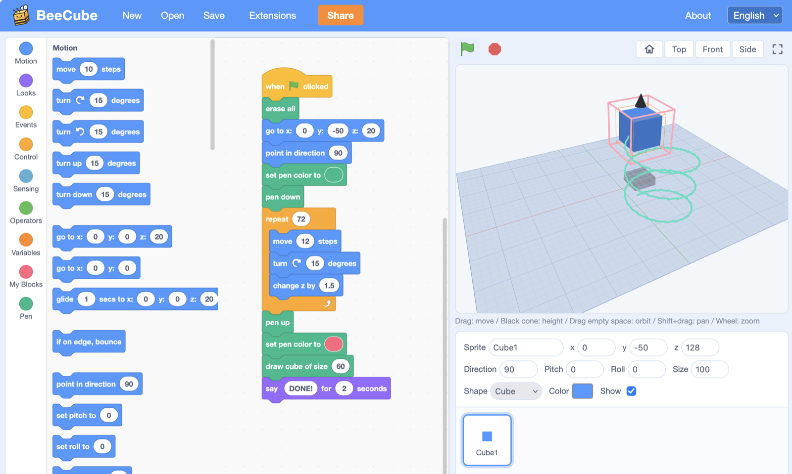
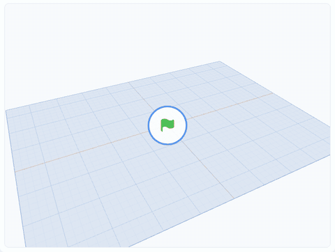

<h1>
  <picture>
    <source media="(prefers-color-scheme: dark)" srcset="docs/brand/beecube-logo-dark.svg">
    
  </picture>
</h1>

A block programming environment in the style of Scratch, in 3D: sprites are
3D objects on a 3D stage, programmed with Scratch-style blocks plus blocks
for the z axis. The pen draws wireframes in space, the stage is edited like
Tinkercad, and physics comes as an extension.

**Try it at [beecube.pages.dev](https://beecube.pages.dev)**: it runs in the
browser, with no account.





*[300 cubes dropped with the physics extension](https://beecube.pages.dev/p/cu3dzbbrds)*

> BeeCube is under active development. It is not affiliated with or endorsed
> by the Scratch Foundation; "Scratch" is a trademark of the Scratch Foundation.

## Quick start

Requires a current Node.js LTS release (CI uses Node.js 24).

```sh
cd app
npm install
npm run dev
```

Then open the URL that Vite prints. See [app/README.md](app/README.md) for
tests, benchmarks, the source layout and how the engine works.

## Repository layout

| Path | Contents |
|---|---|
| `app/` | The web app (Vite, React, three.js, scratch-blocks): editor, engine and stage. |
| `docs/` | Design documents: [the overall design](docs/design.md), [the engine](docs/vm-design.md) and [sharing](docs/sharing.md). |
| `AGENTS.md` | Conventions for contributors and AI coding agents. |

## License

Copyright (c) 2026 masataka takeuchi.

Licensed under the [MIT License](LICENSE).

Third-party libraries keep their own licenses; notably
[scratch-blocks](https://github.com/scratchfoundation/scratch-blocks) and
[Rapier](https://rapier.rs) are Apache-2.0, [three.js](https://threejs.org)
is MIT, and the block translations from
[scratch-l10n](https://github.com/scratchfoundation/scratch-l10n) 4.0.46 are
BSD-3-Clause. The full list is generated into `licenses.txt` at build time.
