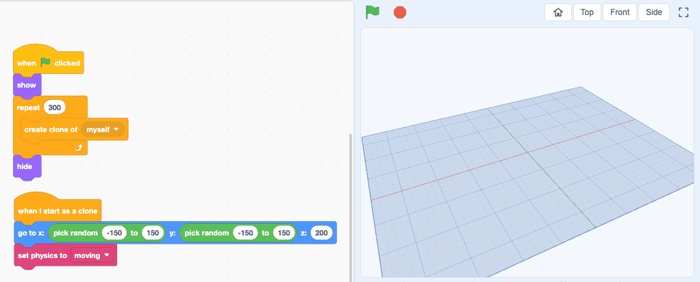

<h1>
  <picture>
    <source media="(prefers-color-scheme: dark)" srcset="docs/brand/beecube-logo-dark.svg">
    
  </picture>
</h1>

Make 3D games and animations by snapping blocks together, in the style of
Scratch. Free, in your browser, with no account.

**Try it at [beecube.pages.dev](https://beecube.pages.dev)**



*Two short scripts drop 300 cubes with physics. [Try this project](https://beecube.pages.dev/p/cu3dzbbrds).*

## Features


*The editor. This script climbs in a spiral with the pen down, then draws a wireframe cube.*

- **Scratch's blocks, in 3D.** Sprites are cubes, spheres, cones and
  cylinders on a 3D stage. Motion gets a z axis, pitch and roll; events,
  control, clones, variables and broadcasts work as in Scratch.
- **The pen draws in space**: lines, and wireframe cubes and spheres.
- **Stage editing like Tinkercad.** Drag a sprite to move it, drag the cone
  above it to lift it, and orbit, pan and zoom the camera.
- **Physics** as an extension, with [Rapier](https://rapier.rs): sprites fall,
  collide and stack.
- **Share with a link.** Shared projects play on phones too, with on-screen
  keys for projects that use the keyboard, and anyone can open one with
  "See inside" to remix it.
- **Made for children.** No accounts and no personal data; sharing is by link
  only, with no public gallery or comments.
- In English and Japanese.

BeeCube is under active development: sounds and costumes are not done yet.
The editor is designed for computers with a mouse and keyboard.

## Run it locally

Requires a current Node.js LTS release (CI uses Node.js 24).

```sh
cd app
npm install
npm run dev
```

Then open the URL that Vite prints. See [app/README.md](app/README.md) for
tests, benchmarks, the source layout, the sharing API and how the engine
works.

## Repository layout

| Path | Contents |
|---|---|
| `app/` | The web app (Vite, React, three.js, scratch-blocks): editor, engine, stage and player, plus the sharing API (Cloudflare Pages Functions). |
| `docs/` | Design documents: [the overall design](docs/design.md), [the engine](docs/vm-design.md) and [sharing](docs/sharing.md). |
| `AGENTS.md` | Conventions for contributors and AI coding agents. |

## License

Copyright (c) 2026 masataka takeuchi.

Licensed under the [MIT License](LICENSE).

Third-party libraries keep their own licenses; notably
[scratch-blocks](https://github.com/scratchfoundation/scratch-blocks) and
[Rapier](https://rapier.rs) are Apache-2.0, [three.js](https://threejs.org)
is MIT, and the block translations from
[scratch-l10n](https://github.com/scratchfoundation/scratch-l10n) 4.0.46 are
BSD-3-Clause. The full list is generated into `licenses.txt` at build time.

BeeCube is not affiliated with or endorsed by the Scratch Foundation.
"Scratch" is a trademark of the Scratch Foundation.
